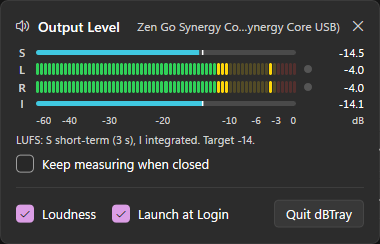

# dBTray

A Windows 11 tray app that shows a real-time stereo level meter for everything your PC is playing. It is the Windows counterpart of [dBar](https://github.com/tosiabunio/dBar) for macOS.

<p align="center"></p>

Click the dBTray icon (two rows of level segments) in the notification area to open the meter:

- **L / R bars**: peak level in dBFS (IEC 60268-18 scale). Green is below −12 dB, yellow is −12 to −3 dB, red is above −3 dB.
- **Peak hold**: a single lit segment marks the recent peak and falls back on its own. The number on the right is the highest peak since the last reset, in dB.
- **Clip indicator**: latches red when a channel reaches 0 dBFS.
- **Loudness** (optional, turn on with the *Loudness* checkbox): short-term (S, last 3 s) and integrated (I) loudness in LUFS, measured per ITU-R BS.1770, as thin bars above and below the peak bars. A marker shows the −14 LUFS target most streaming services normalize to, and the bar turns orange past it. Tick *Keep measuring when closed* to let integrated loudness keep adding up after you close the meter; the icon's tooltip says so while it does.
- **Reset**: click any meter row to reset the peaks and clip indicators of both channels and start integrated loudness over.
- **Launch at Login**: starts dBTray when you sign in. It uses the per-user `Run` registry key, so it appears under Settings › Apps › Startup. Turn it on from the copy of the app you'll keep using.

The meter closes when you click anywhere else or press Esc. Tab, Space and Enter work the options; right-click the icon for *Open Meter* and *Quit dBTray*.

## Download and run

Get `dBTray.exe` from the latest [release](https://github.com/tosiabunio/dBTray/releases/latest). It's one small file (about 270 KB) for x64 PCs that needs no installer and no runtime: put it in a folder you like and run it. It needs Windows 11; it should also run on Windows 10 (1903 or later), which hasn't been tested.

- Windows 11 tucks new tray icons away behind the **^** arrow. Drag the dBTray icon onto the taskbar, or turn it on under Settings › Personalization › Taskbar › Other system tray icons. Until then, running `dBTray.exe` again opens the meter.
- The options are saved in `dBTray.ini` next to the executable, so the folder is all there is to copy or delete. If that folder isn't writable (Program Files, say), they go to `%APPDATA%\dBTray\dBTray.ini` instead.
- *Launch at Login* is the only thing dBTray writes outside its folder. Untick it before deleting the app.
- The executable isn't signed, so SmartScreen may warn the first time you run a downloaded copy: choose **More info › Run anyway**.

No permission is needed: Windows lets apps listen to the output mix, and shows no recording indicator for it. Audio is never recorded or stored.

## Build from source

You need the Visual Studio 2022 C++ tools (the free [Build Tools](https://visualstudio.microsoft.com/downloads/#build-tools-for-visual-studio-2022) with *Desktop development with C++* are enough). From the repository folder:

```
build.cmd
```

This writes `build\x64\dBTray.exe`. `build.cmd arm64` builds for ARM64 if those tools are installed, and `build.cmd test` runs the loudness tests. `tools\make-icon.ps1` regenerates `res\dBTray.ico`.

## How it works

- `AudioCapture` opens a WASAPI loopback stream on the default output device and asks the audio engine for a stereo float mixdown. A capture thread reads it every 10 ms and measures per-channel peaks. When the default output device changes, capture moves to the new one.
- `LevelMeterModel` drains those peaks about 60 times a second and applies meter ballistics: instant attack, 24 dB/s release, 1.5 s peak hold.
- `LoudnessAnalyzer` applies BS.1770 K-weighting on the capture thread and emits 100 ms blocks of power. `LoudnessMeter` turns them into short-term loudness and gated integrated loudness (−70 LUFS absolute gate, −10 LU relative gate). It matches the EBU Tech 3341 sine-wave reference cases within 0.1 LU (`tests\LoudnessTests.cpp`).
- Windows delivers no loopback audio while nothing is playing. The capture thread feeds the loudness analyzer the missing silence, so short-term loudness falls back the way it should.
- `MeterWindow` draws the flyout with Direct2D and follows Windows' dark and light modes and accent colour. `TrayIcon` draws the icon for the taskbar's theme and size.
- Capture runs only while the meter is open, so the app uses no CPU otherwise, and the graphics resources are released when it closes. The exception is *Keep measuring when closed*: capture then carries on after the meter closes (from the first time you open it), refreshing 10 times a second instead of 60.

The meter shows the digital signal apps send to the output device. It follows each app's level in the volume mixer; on most devices the master volume slider does not move the bars.

## Differences from dBar

- dBar leaves per-app volume mixers that replay other apps' audio (FineTune) out of its tap. That is a macOS arrangement with no Windows equivalent, so dBTray has no such exclusion.
- macOS shows a recording indicator while dBar measures in the background; Windows shows none, so dBTray's tooltip reports it.
- dBTray adds a right-click menu on the icon, and opens the meter when started by hand.

## License

[BSD Zero Clause License (0BSD)](LICENSE). You can use, copy, modify and distribute dBTray for any purpose, with or without credit.
